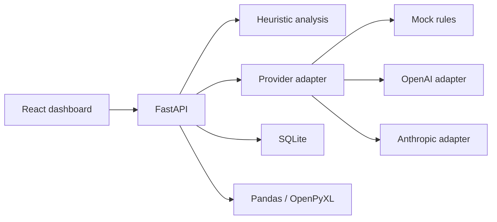

# Architecture

The browser talks only to the API. The API never sends requirement text to a model unless Settings selects OpenAI or Anthropic and the matching key is present in the environment.

## Analysis

`app/services/analysis.py` reads the source once and returns findings. Each finding is `extracted` or `inferred`.

- Extracted findings include a quote from the source.
- Inferred findings describe a gap, such as a missing acceptance-criteria section, and do not invent a quote.

Ambiguous wording is detected with a fixed term list. The quote is the source sentence. The rationale says the label is a term match.

## Generation

`app/services/generator.py` turns the analysis into test cases. The mock provider calls that function and validates every case with the Pydantic schema used for remote JSON as well.

Remote adapters send the same schema instructions. If the response is not valid JSON, the service asks the provider once more with a repair prompt. A second failure is stored as a failed generation run and returned as HTTP 422.

## Persistence

Projects, sources, analyses, suites, cases, generation runs, and one settings row live in SQLite. The first Alembic revision creates those tables from the SQLAlchemy metadata. The application also calls `create_all` on startup so a fresh checkout runs without a manual migration.

## Exports

CSV and Excel are built with Pandas. Excel uses OpenPyXL and adds an About sheet that explains the mock provider. JSON includes the same note and the stored generation metadata.
